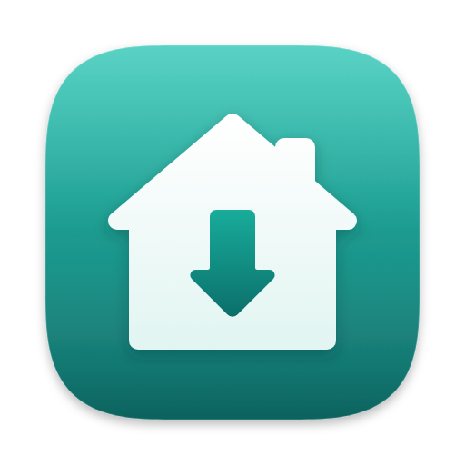

<p align="center">
  
</p>

<h1 align="center">CopyHome</h1>

<p align="center">
  <b>Сервер может упасть. Копия уже дома.</b><br>
  Бекапы серверов для macOS: дампы MySQL и архивы каталогов по SSH, прямо на ваш Mac.
</p>

<p align="center">
  <a href="https://github.com/ilyabazhenov/copyhome/releases/latest/download/CopyHome.dmg"><b>Скачать CopyHome.dmg</b></a>
  ·
  <a href="https://copyhome.app">copyhome.app</a>
  ·
  <a href="#english">English</a>
</p>

---

CopyHome по SSH снимает дампы MySQL и архивы каталогов, скачивает их на Mac, проверяет каждый файл
и кладёт копию в облако. Тихо, по расписанию, из строки меню.

## Возможности

- **Ничего не ставится на сервер.** Нужны только `bash`, `gzip`, `tar` и `mysqldump`, которые почти всегда уже есть.
- **MySQL и каталоги.** Дамп с `--single-transaction` не блокирует таблицы InnoDB. Каталоги архивируются
  с исключениями вроде `cache/` или `node_modules`. Таблицы логов и сессий можно забирать только структурой.
- **Дамп идёт потоком прямо в файл на Mac** и не ложится на диск сервера. Сжатие zstd, pigz или gzip,
  CopyHome сам выберет самое быстрое из доступных на сервере.
- **Проверка каждого файла.** Архив распаковывается до конца, у дампа ищется маркер `Dump completed`,
  у tar конечный маркер. Если снимок вдруг стал на 30% меньше прошлого, придёт предупреждение.
- **Расписание без cron в голове.** Вручную, каждый час, день, неделю или своё cron-выражение.
  Mac спал в 03:00? Пропущенный бекап выполнится, как только он проснётся, а неудачный повторится через 15 и 60 минут.
- **Ротация.** Хранятся последние N копий, на Mac и в облаке отдельно. Старые удаляются только после удачной
  полной копии, так что упавший сервер не съест хорошие бекапы.
- **Копия в облаке.** Яндекс Диск: выгрузка после каждого бекапа со сверкой sha256, большие файлы режутся на части,
  оборванная выгрузка продолжается сама. Google Drive следующим, S3 и WebDAV в планах.
- **Строка меню.** Закрыли окно, а расписание продолжает работать. Стартует при входе в систему.
- **И локально.** Проект «На этом компьютере» снимает дамп MySQL из Docker или Homebrew без SSH.

## Безопасность

- **Без посредников.** Копии идут с сервера прямо на ваш Mac. В облако копия уходит, только если вы подключили своё хранилище.
- **Шифрование age.** Дамп шифруется ещё по пути в файл, в облако уходит уже зашифрованная копия.
  Файл `.age` открывается стандартной утилитой `age`, без CopyHome.
- **Связка ключей macOS.** Пароли MySQL, SSH и токены облаков в открытом виде не лежат нигде.
- **Системный `ssh`.** Работают ваши `~/.ssh/config`, ключи и `ssh-agent`. Смена ключа хоста блокирует подключение.
- **Пароль базы не виден в `ps`**: он уходит на сервер через stdin, а не в аргументах команды.

## Как это работает

1. **Добавьте сервер.** Хост и пользователь, вход по ключу или паролю. Кнопка «Проверить SSH» покажет,
   есть ли на сервере всё нужное.
2. **Выберите, что беречь.** Базы MySQL и каталоги с исключениями.
3. **Задайте расписание.** Сколько копий хранить и нужна ли копия в облаке. Дальше CopyHome всё делает сам
   и пишет, если что-то не так.

Бекапы лежат обычными файлами, которые открываются без CopyHome:

```
~/Backups/fast-backup/<Проект>/<2026-10-17T03-00-00>/
  mysql-shop.sql.zst
  dir-var-www-uploads.tar.gz
  .copyhome.json
```

## Установка

1. Скачайте [CopyHome.dmg](https://github.com/ilyabazhenov/copyhome/releases/latest/download/CopyHome.dmg)
   (все версии в [Releases](https://github.com/ilyabazhenov/copyhome/releases)).
2. Откройте его и перетащите CopyHome в «Программы».
3. Запустите.

Нужна macOS 13 или новее. Одна сборка для Apple Silicon и Intel, подписана и нотаризована Apple.

## Про этот репозиторий

Здесь лежат сайт [copyhome.app](https://copyhome.app) (GitHub Pages, без сборки) и релизы приложения.
`index.html` и `en/index.html` это русская и английская версии страницы, `styles.css` стили, `main.js` анимации
и переключатель темы, `assets/` иконка и картинки для соцсетей.

---

<a id="english"></a>

## English

**Servers fail. Your copy is already home.**

CopyHome is a macOS app that dumps MySQL databases and archives folders over SSH, downloads them to your Mac,
verifies every file and uploads a copy to the cloud. Quietly, on schedule, from the menu bar.

[**Download CopyHome.dmg**](https://github.com/ilyabazhenov/copyhome/releases/latest/download/CopyHome.dmg) ·
[copyhome.app/en](https://copyhome.app/en/)

- **Nothing to install on the server**: just `bash`, `gzip`, `tar` and `mysqldump`.
- **MySQL and folders.** `--single-transaction` dumps don't lock InnoDB tables; folders are archived with excludes;
  log and session tables can be taken schema-only.
- **Streams straight to a file on your Mac**, never touching the server's disk. zstd, pigz or gzip, picked automatically.
- **Every file is verified** by decompressing it to the end. A snapshot that shrinks by more than 30% triggers a warning.
- **Schedules without cron in your head**: manual, hourly, daily, weekly or a custom cron expression.
  Missed runs catch up when the Mac wakes, failed ones retry after 15 and 60 minutes.
- **Rotation** keeps the last N copies, locally and in the cloud, and only deletes after a good full copy.
- **Cloud copy** to Yandex Disk with sha256 checks, chunked uploads and resume. Google Drive is next, S3 and WebDAV are planned.
- **Security**: no middleman, optional age encryption, secrets in the macOS keychain, system `ssh`,
  and the database password goes over stdin, so it never shows up in `ps`.

Requires macOS 13 or later. Universal build for Apple Silicon and Intel, signed and notarized by Apple.
